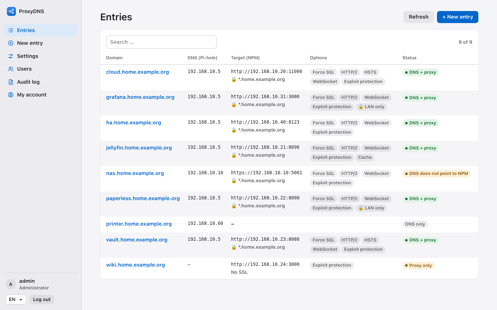
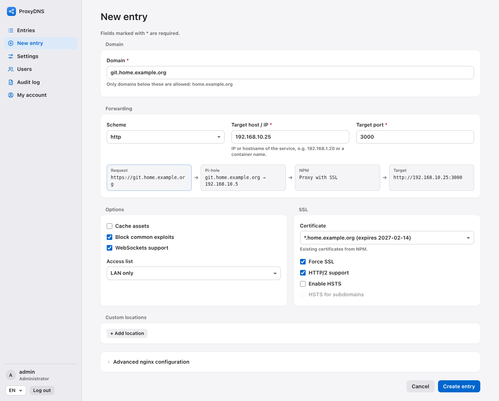
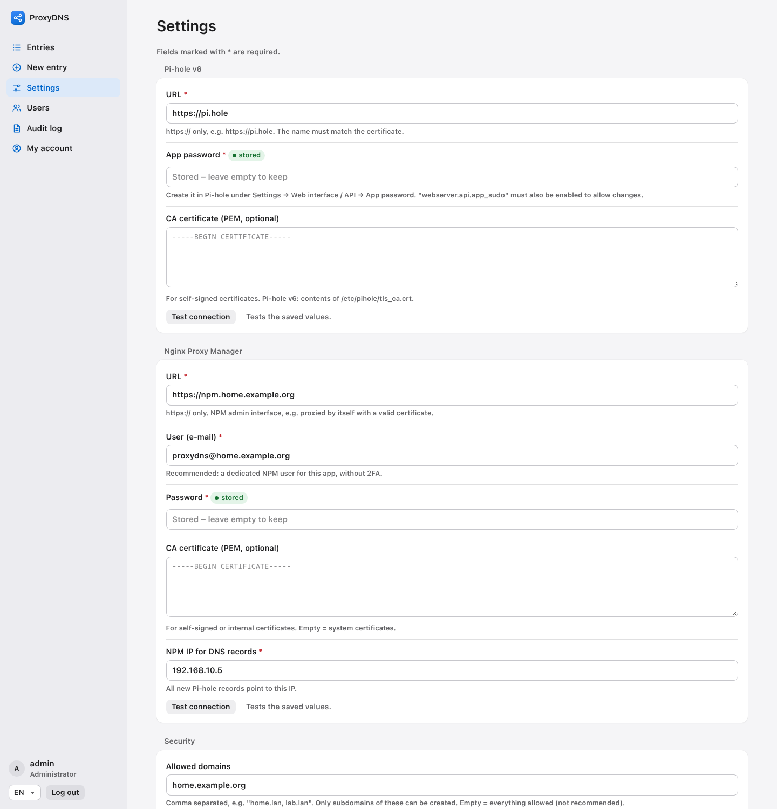
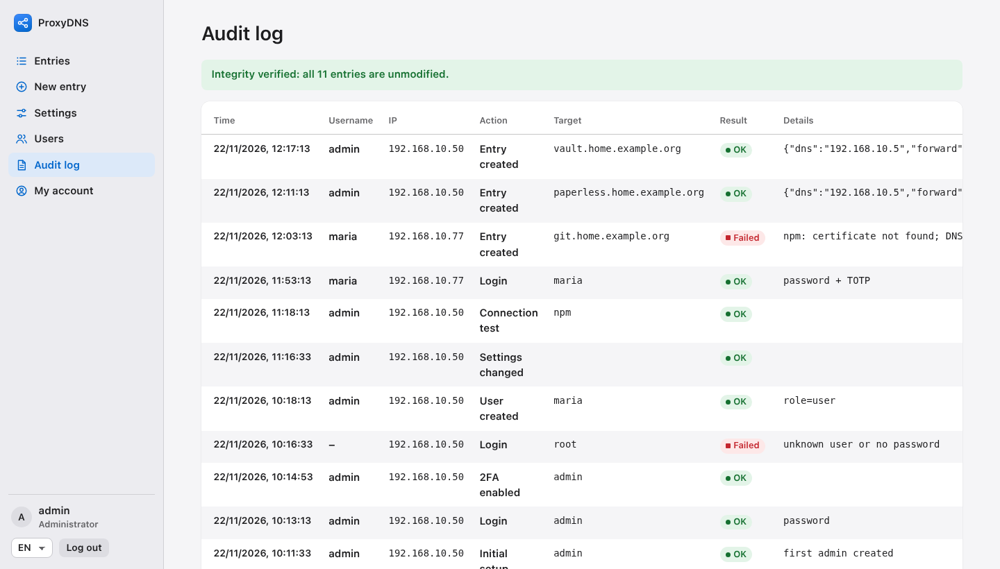

# ProxyDNS Manager

[Deutsch](README.md) | **English**

[](https://github.com/dockercraft-yt/proxydns/releases)

[](https://github.com/dockercraft-yt/proxydns/actions/workflows/ci.yml)

Creates a local DNS record in **Pi-hole v6** and the matching proxy host in
**Nginx Proxy Manager (NPM)** in **one step**. If NPM fails, the DNS record is removed again
automatically.

```
app.home.lan  ──Pi-hole──▶  NPM's IP  ──NPM──▶  http://192.168.1.20:8080
```

Runs as a **Docker container** (web UI on your LAN) or as a **desktop app** with its own window
on Windows and Linux (no open network port).

> [!WARNING]
> **ALPHA version** – early test release. Features, UI and data format may still change, and bugs
> are likely. Please don't use it as the only way to manage important systems, and back up your
> data before updating (Docker volume or `~/.config/proxydns/`).

<picture>
  <source media="(prefers-color-scheme: dark)" srcset="docs/screenshots/entries-en-dark.png">
  
</picture>

## Contents

- [Features](#features)
- [Quick start with Docker](#quick-start-with-docker)
- [Desktop app (Windows / Linux)](#desktop-app-windows--linux)
- [Preparing Pi-hole and NPM](#preparing-pi-hole-and-npm)
- [Security](#security)
- [More screenshots](#more-screenshots)
- [Building and contributing](#building-and-contributing)

## Features

- **Overview** of all entries – Pi-hole and NPM merged, with a status
  (e.g. "DNS does not point to NPM" or "Proxy only")
- **New entry in a single form** with all relevant NPM options: existing certificates,
  Force SSL, HTTP/2, HSTS (+ subdomains), WebSockets, exploit blocking, caching, access lists,
  custom locations, advanced nginx configuration (admins only)
- Automatic **rollback**: if NPM fails, the DNS record is removed again
- Users with roles **admin** / **user**, optional **TOTP 2FA**, optional **OIDC / SSO**
  (Docker only)
- **Audit log**, cryptographically chained – tampering with the database is detected
- UI in **German / English**, light and dark theme follow the system

<picture>
  <source media="(prefers-color-scheme: dark)" srcset="docs/screenshots/new-en-dark.png">
  
</picture>

## Quick start with Docker

```bash
cp .env.example .env
# enter a long passphrase, e.g.:  openssl rand -base64 32
nano .env

docker compose up -d      # pulls the image ghcr.io/dockercraft-yt/proxydns
docker logs proxydns      # shows the setup code
```

Then open `http://<server>:8080`, enter the setup code and create the first admin, and finally
enter the connections to Pi-hole and NPM (see [Preparing Pi-hole and NPM](#preparing-pi-hole-and-npm)).

> [!IMPORTANT]
> **Keep the passphrase safe!** Without it the app no longer starts, because the stored
> credentials cannot be decrypted.

Instead of the environment variable you can use a **Docker secret** (not visible via
`docker inspect`) – see the comments in `docker-compose.yml`.

**Updating:** bump the tag in `docker-compose.yml`, then `docker compose pull && docker compose up -d`.
To build the image yourself instead of pulling it, see the comment at `image:` in `docker-compose.yml`.

### Environment variables

| Variable | Default | Meaning |
|---|---|---|
| `PROXYDNS_MASTER_PASSPHRASE` / `PROXYDNS_MASTER_PASSPHRASE_FILE` | – | master passphrase (min. 16 characters) |
| `PROXYDNS_LISTEN` | `0.0.0.0:8080` (Docker) | address/port |
| `PROXYDNS_TLS_CERT`, `PROXYDNS_TLS_KEY` | – | HTTPS for the app itself |
| `PROXYDNS_SECURE_COOKIES` | `false` | `true` if the app runs behind HTTPS (e.g. NPM) |
| `PROXYDNS_TRUST_PROXY` | `false` | honour `X-Forwarded-For` (only behind your own proxy) |
| `PROXYDNS_SESSION_IDLE` / `PROXYDNS_SESSION_MAX` | `30m` / `12h` | session lifetime |

### Emergency commands

```bash
docker exec proxydns proxydns reset-password <user>   # new random password
docker exec proxydns proxydns reset-mfa <user>        # disable 2FA
```

## Desktop app (Windows / Linux)

Download the matching file from the [releases](https://github.com/dockercraft-yt/proxydns/releases)
and run it:

- **Windows:** `proxydns-desktop-windows-amd64.exe` (needs WebView2 – preinstalled on Windows 10/11)
- **Linux:** `proxydns-desktop-linux-amd64` (needs WebKitGTK 4.1, e.g. Arch/CachyOS: `webkit2gtk-4.1`)

Data is stored in your user profile – `~/.config/proxydns/` on Linux, `%AppData%\proxydns\` on
Windows: `master.key`, `proxydns.db` and `proxydns.log`.

> [!IMPORTANT]
> **Back up `master.key`** – without it the stored credentials are lost.

OIDC is not available in the desktop app.

## Preparing Pi-hole and NPM

### Pi-hole v6

1. *Settings → Web interface / API → Expert*: create an **app password** and activate it with
   **"Enable new app password"**.
2. Enable `webserver.api.app_sudo` (*Settings → All settings → Webserver and API*),
   otherwise the app password is not allowed to create records.
3. Enter the URL **with https**, e.g. `https://pi.hole`.
   Pi-hole uses a self-signed certificate: paste the content of `/etc/pihole/tls_ca.crt` into the
   *CA certificate* field. The host name in the URL must be contained in the certificate
   (default: `pi.hole`, configurable via `webserver.domain`).

### Nginx Proxy Manager

1. Create a dedicated user for the app (**without 2FA**) with permissions: manage proxy hosts,
   view certificates and access lists.
2. Make the NPM admin UI reachable via **HTTPS** (e.g. NPM as its own proxy host with a
   certificate) and enter that URL.
3. Set the **NPM IP for DNS records** – all new Pi-hole records point to this IP.

### Recommended

Set *allowed domains* (e.g. `home.lan`) so nobody can redirect foreign domains.

## Security

| What | How |
|---|---|
| API credentials (Pi-hole, NPM, OIDC secret) | encrypted with **AES-256-GCM** in SQLite, each value bound to its field. Never returned to the UI. |
| Master key (Docker) | derived via **Argon2id** from `PROXYDNS_MASTER_PASSPHRASE` (or a Docker secret); passphrase and key are wiped from memory after derivation. An environment variable stays visible via `docker inspect` – the Docker secret is therefore the safer option. |
| Master key (desktop) | generated randomly on first start, file `master.key` with mode `0600` |
| User passwords | **Argon2id** (64 MiB, t=3), min. 12 characters |
| Login protection | 5 failed attempts → account locked for 15 min; additional per-IP limit; no user enumeration |
| Sessions | random tokens, stored only as SHA-256 hash; 30 min idle / max. 12 h; HttpOnly + SameSite=Strict |
| CSRF | session-bound token + mandatory header on all state-changing requests |
| 2FA (TOTP) | seed encrypted, codes usable only once (replay protection), max. 5 attempts |
| Connection to Pi-hole/NPM | **`https://` only**, certificate is **always** verified (optional custom CA PEM), no redirects |
| Domains | optional list of allowed domains (e.g. only `*.home.lan`), strict validation of all input |
| First-time setup (Docker) | one-time code from the container log required to create the first admin |
| Web UI | strict Content Security Policy, no inline scripts, no `innerHTML` |
| Container | distroless, no shell, non-root, read-only, no capabilities |

## More screenshots

<details>
<summary><b>Settings</b> – connections to Pi-hole and NPM, allowed domains</summary>

<picture>
  <source media="(prefers-color-scheme: dark)" srcset="docs/screenshots/settings-en-dark.png">
  
</picture>
</details>

<details>
<summary><b>Audit log</b> – with integrity check of the hash chain</summary>

<picture>
  <source media="(prefers-color-scheme: dark)" srcset="docs/screenshots/audit-en-dark.png">
  
</picture>
</details>

## Building and contributing

Building only requires Docker (no local Go installation):

```bash
scripts/build.sh all
```

Details on building, tests, project layout and releases are in [CONTRIBUTING.md](CONTRIBUTING.md).
