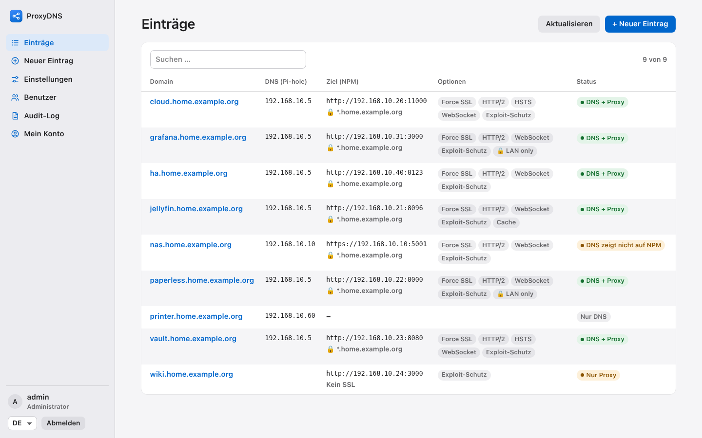
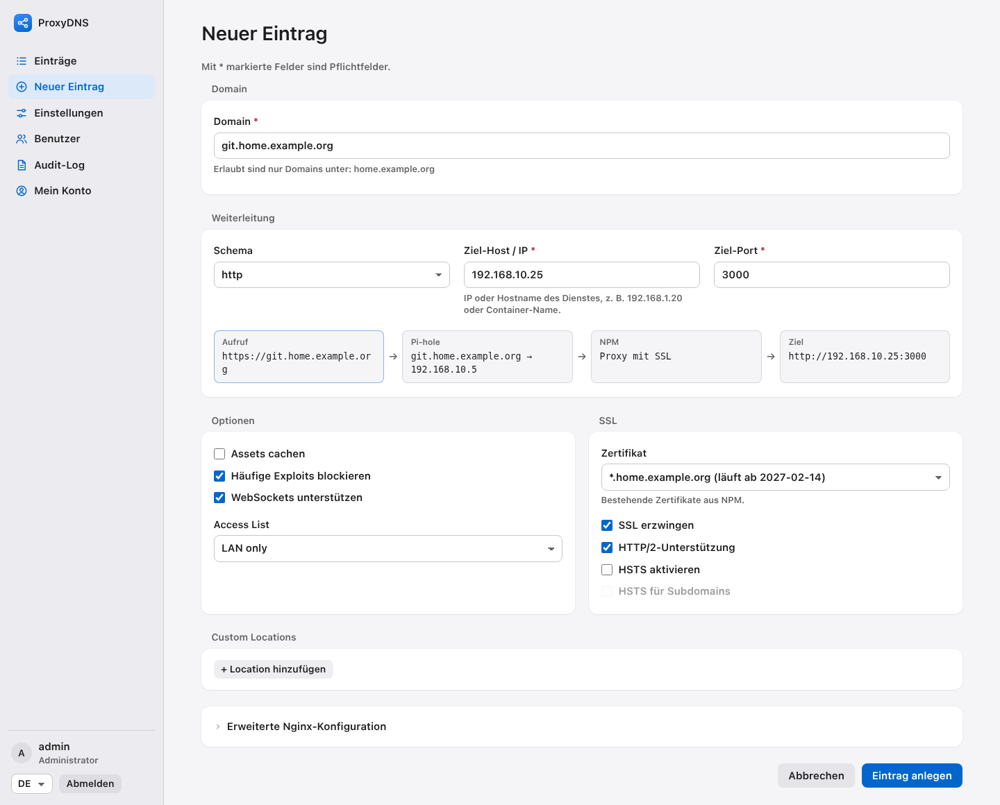
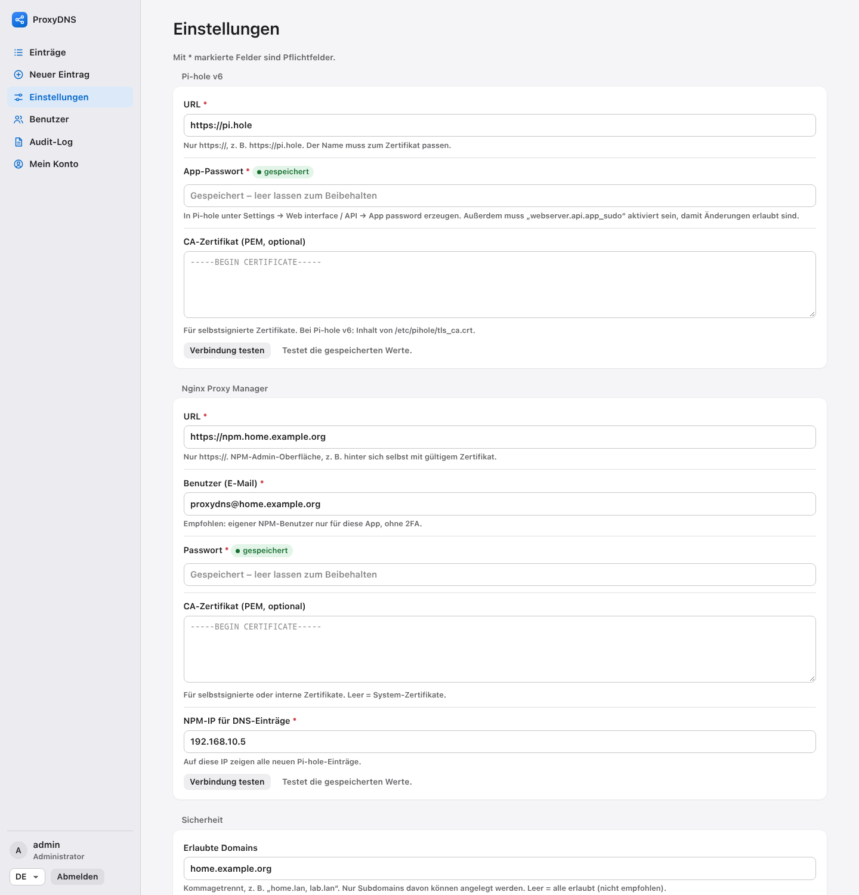
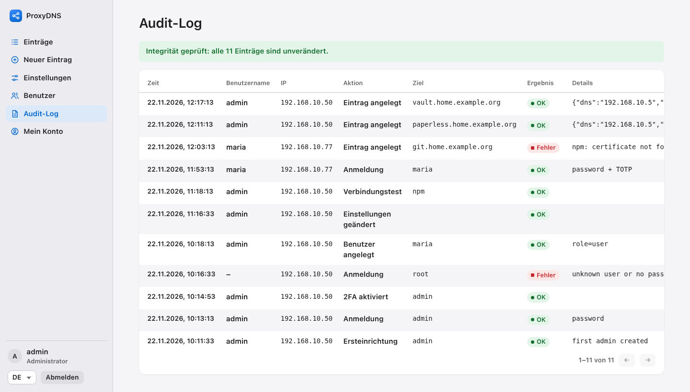

# ProxyDNS Manager

**Deutsch** | [English](README.en.md)

[](https://github.com/dockercraft-yt/proxydns/releases)

[](https://github.com/dockercraft-yt/proxydns/actions/workflows/ci.yml)

Legt in **einem Schritt** einen lokalen DNS-Eintrag in **Pi-hole v6** und den passenden
Proxy-Host in **Nginx Proxy Manager (NPM)** an. Schlägt NPM fehl, wird der DNS-Eintrag automatisch
wieder entfernt.

```
app.home.lan  ──Pi-hole──▶  IP von NPM  ──NPM──▶  http://192.168.1.20:8080
```

Läuft als **Docker-Container** (Weboberfläche im LAN) oder als **Desktop-App** mit eigenem
Fenster unter Windows und Linux (ohne offenen Netzwerk-Port).

> [!WARNING]
> **ALPHA-Version** – frühe Testversion. Funktionen, Bedienung und das Datenformat können sich
> noch ändern, Fehler sind wahrscheinlich. Bitte nicht als einzige Verwaltung für wichtige Systeme
> einsetzen und vor Updates die Daten sichern (Docker-Volume bzw. `~/.config/proxydns/`).

<picture>
  <source media="(prefers-color-scheme: dark)" srcset="docs/screenshots/entries-de-dark.png">
  
</picture>

## Inhalt

- [Funktionen](#funktionen)
- [Schnellstart mit Docker](#schnellstart-mit-docker)
- [Desktop-App (Windows / Linux)](#desktop-app-windows--linux)
- [Pi-hole und NPM vorbereiten](#pi-hole-und-npm-vorbereiten)
- [Sicherheitskonzept](#sicherheitskonzept)
- [Weitere Screenshots](#weitere-screenshots)
- [Selbst bauen und mitwirken](#selbst-bauen-und-mitwirken)

## Funktionen

- **Übersicht** aller Einträge – Pi-hole und NPM zusammengeführt, mit Status
  (z. B. „DNS zeigt nicht auf NPM“ oder „Nur Proxy“)
- **Neuer Eintrag in einem Formular** mit allen wichtigen NPM-Optionen: vorhandene Zertifikate,
  Force SSL, HTTP/2, HSTS (+ Subdomains), WebSockets, Exploit-Schutz, Caching, Access Lists,
  Custom Locations, erweiterte Nginx-Konfiguration (nur Admins)
- Automatischer **Rollback**: schlägt NPM fehl, wird der DNS-Eintrag wieder entfernt
- Benutzer mit den Rollen **admin** / **user**, optional **TOTP-2FA**, optional **OIDC / SSO**
  (nur Docker)
- **Audit-Log**, kryptografisch verkettet – Manipulationen an der Datenbank werden erkannt
- Oberfläche auf **Deutsch / Englisch**, helles und dunkles Design automatisch

<picture>
  <source media="(prefers-color-scheme: dark)" srcset="docs/screenshots/new-de-dark.png">
  
</picture>

## Schnellstart mit Docker

```bash
cp .env.example .env
# lange Passphrase eintragen, z. B.:  openssl rand -base64 32
nano .env

docker compose up -d      # lädt das Image ghcr.io/dockercraft-yt/proxydns
docker logs proxydns      # zeigt den Einrichtungscode
```

Dann `http://<server>:8080` öffnen, Einrichtungscode und ersten Admin eingeben und anschließend
die Verbindungen zu Pi-hole und NPM eintragen (siehe [Pi-hole und NPM vorbereiten](#pi-hole-und-npm-vorbereiten)).

> [!IMPORTANT]
> **Passphrase gut aufbewahren!** Ohne sie startet die App nicht mehr, weil die gespeicherten
> Zugangsdaten sonst nicht entschlüsselt werden können.

Statt der Umgebungsvariable kann ein **Docker-Secret** genutzt werden (nicht per
`docker inspect` sichtbar) – siehe Kommentare in `docker-compose.yml`.

**Update:** Tag in `docker-compose.yml` anheben, dann `docker compose pull && docker compose up -d`.
Selbst bauen statt Image laden: siehe Kommentar bei `image:` in `docker-compose.yml`.

### Umgebungsvariablen

| Variable | Standard | Bedeutung |
|---|---|---|
| `PROXYDNS_MASTER_PASSPHRASE` / `PROXYDNS_MASTER_PASSPHRASE_FILE` | – | Master-Passphrase (min. 16 Zeichen) |
| `PROXYDNS_LISTEN` | `0.0.0.0:8080` (Docker) | Adresse/Port |
| `PROXYDNS_TLS_CERT`, `PROXYDNS_TLS_KEY` | – | eigenes HTTPS für die App selbst |
| `PROXYDNS_SECURE_COOKIES` | `false` | `true`, wenn die App hinter HTTPS (z. B. NPM) läuft |
| `PROXYDNS_TRUST_PROXY` | `false` | `X-Forwarded-For` auswerten (nur hinter eigenem Proxy) |
| `PROXYDNS_SESSION_IDLE` / `PROXYDNS_SESSION_MAX` | `30m` / `12h` | Sitzungsdauer |

### Notfall-Befehle

```bash
docker exec proxydns proxydns reset-password <benutzer>   # neues Zufallspasswort
docker exec proxydns proxydns reset-mfa <benutzer>        # 2FA abschalten
```

## Desktop-App (Windows / Linux)

Die passende Datei aus den [Releases](https://github.com/dockercraft-yt/proxydns/releases)
herunterladen und starten:

- **Windows:** `proxydns-desktop-windows-amd64.exe` (benötigt WebView2 – bei Windows 10/11 vorinstalliert)
- **Linux:** `proxydns-desktop-linux-amd64` (benötigt WebKitGTK 4.1, z. B. Arch/CachyOS: `webkit2gtk-4.1`)

Die Daten liegen im Benutzerprofil – unter Linux in `~/.config/proxydns/`, unter Windows in
`%AppData%\proxydns\`: `master.key`, `proxydns.db` und `proxydns.log`.

> [!IMPORTANT]
> **`master.key` sichern** – ohne ihn sind die gespeicherten Zugangsdaten verloren.

OIDC ist in der Desktop-App nicht verfügbar.

## Pi-hole und NPM vorbereiten

### Pi-hole v6

1. *Settings → Web interface / API → Expert*: **App-Passwort** erzeugen und mit
   **„Enable new app password“** aktivieren.
2. `webserver.api.app_sudo` aktivieren (*Settings → All settings → Webserver and API*),
   sonst darf das App-Passwort keine Einträge anlegen.
3. URL **mit https** eintragen, z. B. `https://pi.hole`.
   Pi-hole nutzt ein selbstsigniertes Zertifikat: den Inhalt von `/etc/pihole/tls_ca.crt` ins Feld
   *CA-Zertifikat* kopieren. Der Hostname in der URL muss im Zertifikat stehen
   (Standard: `pi.hole`, änderbar über `webserver.domain`).

### Nginx Proxy Manager

1. Eigenen Benutzer für die App anlegen (**ohne 2FA**), Rechte: Proxy Hosts verwalten,
   Zertifikate und Access Lists lesen.
2. NPM-Admin-Oberfläche per **HTTPS** erreichbar machen (z. B. NPM als eigenen Proxy-Host
   mit Zertifikat) und diese URL eintragen.
3. **NPM-IP für DNS-Einträge** setzen – auf diese IP zeigen alle neuen Pi-hole-Einträge.

### Empfohlen

*Erlaubte Domains* setzen (z. B. `home.lan`), damit niemand fremde Domains umbiegen kann.

## Sicherheitskonzept

| Was | Wie |
|---|---|
| API-Zugangsdaten (Pi-hole, NPM, OIDC-Secret) | **AES-256-GCM** verschlüsselt in SQLite, jeder Wert an sein Feld gebunden. Werden nie an die Oberfläche zurückgegeben. |
| Master-Key Docker | per **Argon2id** aus `PROXYDNS_MASTER_PASSPHRASE` (oder Docker-Secret) abgeleitet; Passphrase und Schlüssel werden nach dem Ableiten im Speicher überschrieben. Eine Umgebungsvariable bleibt per `docker inspect` sichtbar – das Docker-Secret ist deshalb die sicherere Variante. |
| Master-Key Desktop | beim ersten Start zufällig erzeugt, Datei `master.key` mit Rechten `0600` |
| Benutzerpasswörter | **Argon2id** (64 MiB, t=3), min. 12 Zeichen |
| Login-Schutz | 5 Fehlversuche → Konto 15 min gesperrt; zusätzlich IP-Limit; keine Benutzer-Enumeration |
| Sitzungen | zufällige Tokens, in der DB nur als SHA-256-Hash; 30 min Inaktivität / max. 12 h; HttpOnly + SameSite=Strict |
| CSRF | sitzungsgebundenes Token + Pflicht-Header auf allen ändernden Anfragen |
| 2FA (TOTP) | Seed verschlüsselt, Codes nur einmal verwendbar (Replay-Schutz), max. 5 Versuche |
| Verbindung zu Pi-hole/NPM | **nur `https://`**, Zertifikat wird **immer** geprüft (optional eigenes CA-PEM), keine Redirects |
| Domains | optionale Liste erlaubter Domains (z. B. nur `*.home.lan`), strenge Validierung aller Eingaben |
| Erst-Einrichtung (Docker) | Einmal-Code aus dem Container-Log nötig, um den ersten Admin anzulegen |
| Weboberfläche | strikte Content-Security-Policy, kein Inline-Script, kein `innerHTML` |
| Container | distroless, ohne Shell, Non-Root, read-only, ohne Capabilities |

## Weitere Screenshots

<details>
<summary><b>Einstellungen</b> – Verbindungen zu Pi-hole und NPM, erlaubte Domains</summary>

<picture>
  <source media="(prefers-color-scheme: dark)" srcset="docs/screenshots/settings-de-dark.png">
  
</picture>
</details>

<details>
<summary><b>Audit-Log</b> – mit Integritätsprüfung der Hash-Kette</summary>

<picture>
  <source media="(prefers-color-scheme: dark)" srcset="docs/screenshots/audit-de-dark.png">
  
</picture>
</details>

## Selbst bauen und mitwirken

Für den Build wird nur Docker benötigt (kein lokales Go):

```bash
scripts/build.sh all
```

Details zu Build, Tests, Projektstruktur und Releases stehen in [CONTRIBUTING.md](CONTRIBUTING.md).
